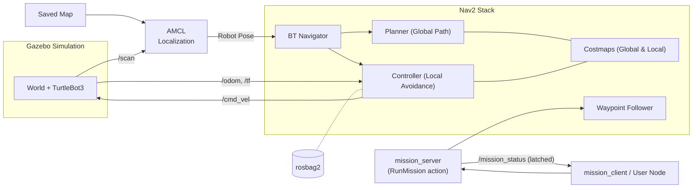

<div align="center">

# 🤖 TurtleBot3 Autonomous Navigation with Nav2

<p><strong>A TurtleBot3 robot navigating switchable Gazebo worlds with ROS 2 Navigation2 (Nav2): dynamic obstacle avoidance, custom ROS interfaces, tuned QoS, rosbag recording, and SROS2 security.</strong></p>

<p>
  
  
  
  
  
</p>

<p>
  <a href="#-quick-start">Quick start</a> •
  <a href="#-real-time-demonstration">Demonstration</a> •
  <a href="#-switching-worlds">Worlds</a> •
  <a href="#-ros-interfaces">Interfaces</a> •
  <a href="#-documentation-index">Docs</a> •
  <a href="docs/TROUBLESHOOTING.md">Troubleshooting</a>
</p>

</div>

---

## 🎬 Real-Time Demonstration

<p align="center">
  
</p>

> [!NOTE]
> **Full Demonstration Video:** [`NAV2_Goals_and_Waypoints.mp4`](./NAV2_Goals_and_Waypoints.mp4) covers the complete 1080p recording with goal execution, waypoint tracking, and dynamic obstacle avoidance in Gazebo & RViz.

---

## 📖 Overview

This project puts a **TurtleBot3 Waffle / Burger** into Gazebo and configures **Nav2** so it can drive to goals and multi-point missions while avoiding obstacles, including dynamic obstacles introduced while the robot is moving. **No custom navigation algorithm is written**; the work is integration, engineering, and automation around standard ROS 2 packages.

### ✨ Features

| Feature | Description |
| :--- | :--- |
| 🚀 **One-Command Launch** | `ros2 launch nav2-demo nav2-demo.launch.py` starts Gazebo, Nav2, RViz, and localizes the robot |
| 🧭 **Auto Mapping** | `scripts/auto_map.sh <world>` explores and maps autonomously |
| 🎛️ **Nav2 Profiles** | `nav_profile:=default`, `tuned`, `rpp`, `mppi` (per-model and per-world overrides) |
| 🚶 **Moving Obstacles** | `dynamic_obstacles:=true` spawns patrolling cylinder obstacles |
| 🧪 **Tests & CI** | Automated pytest logic tests and verification suite |
| 🧰 **Dev Container** | One-click VS Code development environment |
| 🤖 **Switchable Robot** | `model:=burger`, `waffle` or `waffle_pi` |
| 🐳 **Docker** | Run everything in a container, GPU optional |
| 🌍 **Switchable Worlds** | `world:=tb3_world`, `house`, `stage4`, `aws_house`, `aws_warehouse` from a single launch file |
| 🗺️ **SLAM Mode** | `mode:=slam` builds a map; `scripts/save_map.sh` stores it |
| 🧩 **Custom ROS Interfaces** | `RunMission` action, `SetInitialPose` service, `MissionStatus` topic via `nav2_demo_interfaces` |
| 📡 **Explicit QoS** | Named profiles plus recorder overrides |
| 💾 **rosbag2** | `record:=true`, compressed, QoS-aware |
| 🔐 **Security** | Localhost-only and domain isolation, optional SROS2 (shared or per-node enclaves) |
| 🎮 **GPU Rendering** | `gpu:=true` for NVIDIA PRIME offload |

---

## 🧩 How It Works



- **AMCL (Adaptive Monte Carlo Localization):** Localizes the robot on the map using 2D LiDAR scans.
- **Global Planner (NavFn / Smac):** Computes collision-free paths from the robot's current pose to the target.
- **Local Controller (DWB / RPP / MPPI):** Follows the path and dynamically maneuvers around obstacles detected by LiDAR.
- **Costmaps (Global & Local):** Inflate static map walls and dynamic obstacles to enforce safe robot clearances.

---

## 🚀 Quick Start

Requires **Ubuntu 22.04** and **ROS 2 Humble** (`ros-humble-desktop`). Beginners can refer to the [getting started guide](docs/GETTING_STARTED.md).

```bash
git clone https://github.com/gaminization/NAV2-Demonstration.git
cd NAV2-Demonstration
./scripts/install.sh            # install dependencies
./scripts/build.sh              # build workspace with colcon
source scripts/env.sh           # run in every new terminal
./scripts/check_system.sh       # optional environment health check

# Launch the simulation and navigation
ros2 launch nav2-demo nav2-demo.launch.py world:=tb3_world gpu:=true
```

**Prefer Docker?** (no ROS host installation required, see [docs/DOCKER.md](docs/DOCKER.md)):

```bash
./scripts/docker.sh build
./scripts/docker.sh up tb3_world waffle        # GPU=1 for NVIDIA
```

In a second terminal (after `source scripts/env.sh`, or via `./scripts/docker.sh exec <cmd>`):

```bash
ros2 run nav2-demo mission_client            # robot visits the world's waypoints
./scripts/spawn_obstacle.sh spawn -1.2 -0.5  # drop a dynamic obstacle in its path
```

---

## 🤖 Switching Robot Models

```bash
ros2 launch nav2-demo nav2-demo.launch.py model:=burger      # burger | waffle | waffle_pi
```

Defaults to `$TURTLEBOT3_MODEL` or `waffle`. Nav2 automatically selects the matching parameter configuration. See [docs/ROBOT_MODELS.md](docs/ROBOT_MODELS.md).

---

## 🧭 Automatic & Manual Mapping

### Autonomous Mapping

```bash
./scripts/auto_map.sh house                  # robot explores, generates and installs the map
ros2 launch nav2-demo nav2-demo.launch.py world:=house
```

Details and limits: [docs/EXPLORATION.md](docs/EXPLORATION.md).

### Manual SLAM Mapping

```bash
# 1. Start SLAM mode
ros2 launch nav2-demo nav2-demo.launch.py world:=house mode:=slam

# 2. Drive using keyboard teleoperation in another terminal
ros2 run turtlebot3_teleop teleop_keyboard

# 3. Save the built map
./scripts/save_map.sh house_map
```

---

## 🎛️ Nav2 Tuning Profiles & Moving Obstacles

```bash
ros2 launch nav2-demo nav2-demo.launch.py nav_profile:=rpp dynamic_obstacles:=true
```

Profiles adjust the stock TurtleBot3 controller, planner, and costmap inflation settings without overwriting package defaults. See [docs/NAV_TUNING.md](docs/NAV_TUNING.md) and [docs/DYNAMIC_OBSTACLES.md](docs/DYNAMIC_OBSTACLES.md).

---

## 🌍 Switching Worlds

```bash
./scripts/auto_map.sh house                                       # 1. Build map
ros2 launch nav2-demo nav2-demo.launch.py world:=house            # 2. Navigate
```

| World (`world:=`) | Difficulty | Map Status |
| :--- | :--- | :--- |
| `tb3_world` | Easy | Included |
| `house` | Medium | Build via auto-mapping / SLAM |
| `stage4` | Medium | Build via auto-mapping / SLAM |
| `aws_house` | Advanced | Install with `scripts/install_aws_worlds.sh` |
| `aws_warehouse` | Advanced | Install with `scripts/install_aws_worlds.sh` |

Custom `.world` files are supported directly: `world_file:=/path/to/my.world map:=/path/to/my_map.yaml`. Details: [docs/WORLDS.md](docs/WORLDS.md).

---

## ⚙️ Launch Arguments

| Argument | Default | Meaning |
| :--- | :--- | :--- |
| `world` | `tb3_world` | World name defined in `config/worlds.yaml` |
| `mode` | `nav` | `nav` (navigation), `slam` (manual mapping), `explore` (auto-mapping) |
| `nav_profile` | `default` | Controller/planner profile: `default`, `tuned`, `rpp`, `mppi` |
| `dynamic_obstacles` | `false` | Spawn moving obstacles in simulation |
| `shutdown_on_done` | `true` | In `explore` mode, stop processes once mapping completes |
| `model` | `$TURTLEBOT3_MODEL` or `waffle` | `burger`, `waffle`, `waffle_pi` |
| `world_file`, `map` | _empty_ | Direct file path overrides |
| `x_pose`, `y_pose` | _from config_ | Robot spawn coordinates |
| `headless` | `false` | Disable Gazebo GUI window |
| `gpu` | `false` | Enable NVIDIA GPU rendering |
| `nav2_delay` | `10.0` | Startup delay before launching Nav2 |
| `params_file` | _empty_ | Override custom Nav2 parameters `.yaml` |
| `mission_server` | `true` | Launch `RunMission` action server |
| `record` | `false` | Record rosbag2 dataset |
| `bag_dir`, `bag_storage` | `~/nav2_demo_bags`, `sqlite3` | Rosbag destination directory and storage format (`mcap`) |
| `security` | `false` | Enable SROS2 security |
| `security_mode` | `shared` | `shared` or `pernode` enclaves |
| `keystore`, `enclave` | `~/.nav2_demo/keystore`, `/nav2_demo` | SROS2 configuration |

Run `ros2 launch nav2-demo nav2-demo.launch.py --show-args` to print the full argument list in your terminal.

---

## 🧩 ROS Interfaces

Package [`nav2_demo_interfaces`](src/nav2_demo_interfaces) provides dedicated interfaces for automated navigation:

| Type | Name | Purpose |
| :--- | :--- | :--- |
| Action | `/run_mission` | Execute a multi-waypoint sequence with live feedback and cancellation |
| Service | `/set_initial_pose` | Programmatically publish robot pose to AMCL |
| Topic | `/mission_status` | Latched topic broadcasting mission state |

Examples and QoS details: [docs/INTERFACES.md](docs/INTERFACES.md) and [docs/QOS.md](docs/QOS.md).

---

## 💾 Rosbag Recording

```bash
ros2 launch nav2-demo nav2-demo.launch.py record:=true
ros2 bag info ~/nav2_demo_bags/<folder>
```

Details: [docs/BAGS.md](docs/BAGS.md).

---

## 🔐 Security & Hardening

`source scripts/env.sh` sets up localhost-only DDS and an isolated domain ID. For full authentication and encryption:

```bash
./scripts/setup_security.sh
source scripts/env.sh secure
ros2 launch nav2-demo nav2-demo.launch.py security:=true
```

For least-privilege per-node security profiles, see [docs/SECURITY_HARDENING.md](docs/SECURITY_HARDENING.md).

---

## 🧪 Tests

Run the test suite:

```bash
PYTEST_DISABLE_PLUGIN_AUTOLOAD=1 python3 -m pytest src/nav2-demo/test
```

See [docs/TESTING.md](docs/TESTING.md).

---

## 📁 Repository Structure

```
NAV2-Demonstration/
├── src/
│   ├── nav2_demo_interfaces/         # msg / srv / action interface definitions
│   └── nav2-demo/                    # ROS 2 demonstration package
│       ├── launch/nav2-demo.launch.py# Unified one-command launch file
│       ├── config/worlds.yaml        # World registry, spawn poses, waypoints, obstacles
│       ├── config/nav_profiles.yaml  # Nav2 tuning profiles (default, tuned, rpp, mppi)
│       ├── config/qos/               # QoS configuration profiles
│       ├── maps/                     # Environment maps
│       ├── test/                     # Unit and integration test suite
│       └── nav2_demo/                # Nodes: mission_server, mission_client, explorer, etc.
├── docker/                           # Dockerfile and entrypoint script
├── docker-compose.yml                # Docker Compose deployment (+ docker-compose.gpu.yml)
├── scripts/                          # Automated install, build, environment, and test scripts
├── docs/                             # In-depth architectural and usage documentation
├── assets/                           # Media and demonstration animations
├── NAV2_Goals_and_Waypoints.mp4      # Full walkthrough video
├── SECURITY.md
└── LICENSE
```

---

## 📚 Documentation Index

| Guide | Description |
| :--- | :--- |
| [Getting Started](docs/GETTING_STARTED.md) | Beginner step-by-step setup walkthrough |
| [Docker Setup](docs/DOCKER.md) | Containerized simulation and workflow |
| [Dev Container](docs/DEVCONTAINER.md) | VS Code devcontainer configuration |
| [Exploration & SLAM](docs/EXPLORATION.md) | Frontier-based autonomous mapping |
| [Nav Tuning](docs/NAV_TUNING.md) | Controllers, planners, and parameter overrides |
| [Moving Obstacles](docs/DYNAMIC_OBSTACLES.md) | Dynamic obstacle avoidance setup |
| [Testing & Verification](docs/TESTING.md) | Running unit tests and verification |
| [Robot Models](docs/ROBOT_MODELS.md) | Configuring Waffle, Burger, and Waffle Pi |
| [Worlds & Maps](docs/WORLDS.md) | Adding custom worlds, maps, and waypoints |
| [ROS Interfaces](docs/INTERFACES.md) | Actions, services, and topic definitions |
| [QoS Configurations](docs/QOS.md) | Reliability, durability, and recorder policies |
| [Rosbag2](docs/BAGS.md) | Recording and replaying navigation datasets |
| [Security & SROS2](docs/SECURITY_HARDENING.md) | Localhost isolation, certificates, and enclaves |
| [GPU Offloading](docs/GPU.md) | Hardware acceleration on NVIDIA GPUs |
| [Troubleshooting](docs/TROUBLESHOOTING.md) | Common errors and solutions |

---

## 🙏 Acknowledgements

- [ROS 2 Navigation2 (Nav2)](https://docs.nav2.org)
- [ROBOTIS TurtleBot3](https://emanual.robotis.com/docs/en/platform/turtlebot3/)
- [Cartographer ROS](https://google-cartographer-ros.readthedocs.io)
- [AWS RoboMaker Environments](https://github.com/aws-robotics)

---

## 📄 License

Distributed under the [MIT License](LICENSE).

## 👤 Author

**Garv Arora** • GitHub: [@gaminization](https://github.com/gaminization)  
Repository: [NAV2-Demonstration](https://github.com/gaminization/NAV2-Demonstration)
