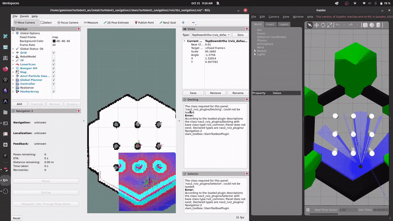

# TurtleBot3 + Nav2 Autonomous Navigation (One-Command Launch)

## Real-Time Demonstration

<p align="center">
  
</p>

<video src="NAV2_Goals_and_Waypoints.mp4" controls width="100%">
  Your browser does not support the video tag.
</video>

> 📹 **Full Demo Video:** [`NAV2_Goals_and_Waypoints.mp4`](./NAV2_Goals_and_Waypoints.mp4) (includes complete goal execution, waypoint following, and dynamic obstacle avoidance in Gazebo & RViz).

---

## Overview

Simulates a TurtleBot3 robot in Gazebo and launches the ROS 2 Navigation2 (Nav2) stack so the robot can navigate autonomously to goals and waypoints while avoiding obstacles in real time. It uses existing ROS 2 Humble packages and provides a unified, single-command launch with automated initial pose publishing.

**Tested target:** Ubuntu 22.04, ROS 2 Humble, Gazebo Classic, TurtleBot3 (Waffle / Burger), Nav2.

---

## Repository Layout

```
.
├── install.sh                       # Installs requirements, configures environment & builds workspace
├── src/nav2-demo/                   # ROS 2 demonstration package
│   ├── launch/nav2-demo.launch.py   # Launches Gazebo + Nav2 + RViz + initial pose
│   ├── package.xml                  # Package metadata and dependencies
│   └── CMakeLists.txt               # Build configuration
├── maps/                            # Storage for custom saved maps (e.g. house world)
├── assets/
│   └── demo.gif                     # Animated demonstration preview
├── NAV2_Goals_and_Waypoints.mp4     # Full demonstration video
└── README.md
```

---

## 1. Installation & Environment Setup

ROS 2 Humble must already be installed on your Ubuntu 22.04 machine ([official guide](https://docs.ros.org/en/humble/Installation/Ubuntu-Install-Debs.html)).

Clone this repository and run the setup script:

```bash
git clone https://github.com/gaminization/NAV2-Demonstration.git
cd NAV2-Demonstration
chmod +x install.sh
./install.sh
source ~/.bashrc
source install/setup.bash
```

The `install.sh` script:
- Installs Gazebo Classic, Nav2, TurtleBot3, SLAM Toolbox, and `colcon`.
- Configures environment variables (`TURTLEBOT3_MODEL=waffle`, `GAZEBO_MODEL_PATH`, and ROS 2 setup) in `~/.bashrc`.
- Automatically builds the workspace (`colcon build --symlink-install`).

---

## 2. Run (One-Command Launch)

To launch the complete simulation, Nav2 stack, RViz, and automatically localize the robot:

```bash
ros2 launch nav2-demo nav2-demo.launch.py
```

This starts:
1. **Gazebo Classic** with the TurtleBot3 arena world.
2. **Nav2 Stack & RViz** after a short delay to allow Gazebo physics and sensors to stabilize.
3. **Automated Initial Pose:** Automatically publishes the initial pose to AMCL on `/initialpose`, eliminating the need to manually set a 2D Pose Estimate in RViz.

---

## 3. Launch Arguments

Customize the simulation and navigation behavior using launch arguments:

| Argument | Default | Description |
|---|---|---|
| `world` | `world` | `world` (default arena) or `house` (rooms and obstacles) |
| `map` | Prebuilt TB3 map | Path to map `.yaml` file |
| `params_file` | Prebuilt TB3 model params | Path to Nav2 parameter `.yaml` file |
| `model` | `waffle` | TurtleBot3 model: `waffle` or `burger` |
| `nav_delay` | `8.0` | Seconds to wait for Gazebo before starting Nav2 (increase on slower machines) |
| `set_initial_pose` | `true` | Automatically publish initial pose to AMCL |
| `x_pose`, `y_pose` | `-2.0`, `-0.5` | Initial pose coordinates matching robot spawn location |

### Example

```bash
ros2 launch nav2-demo nav2-demo.launch.py model:=burger nav_delay:=12.0
```

---

## 4. Navigation & Waypoints

1. In RViz, select the **Nav2 Goal** tool and click/drag at the desired target location and orientation.
2. The global planner computes the path, and the local controller steers the robot to the goal.
3. **Waypoint Following:** In the RViz Nav2 panel, switch to **Waypoint Following Mode**, click multiple goals across the map, and click **Start Waypoint Following**.
4. If AMCL particles need manual realignment, click **2D Pose Estimate** and drag on the robot's approximate position and heading.

---

## 5. Dynamic Obstacle Avoidance

1. Send a navigation goal across the room.
2. In the Gazebo simulation window, open the **Insert** tab and drop a shape (box or cylinder) into the robot's planned path.
3. The 2D LiDAR detects the new obstacle in real time and inserts it into the local costmap.
4. The local controller and planner instantly replan a smooth collision-free path around the obstacle.

---

## 6. Optional: Mapping & Navigating Complex Worlds (House)

The `house` world offers multiple rooms and obstacles. You can map it using SLAM Toolbox and navigate the custom map:

```bash
# Terminal 1: Launch the House simulation
ros2 launch turtlebot3_gazebo turtlebot3_house.launch.py

# Terminal 2: Launch SLAM Toolbox
ros2 launch slam_toolbox online_async_launch.py use_sim_time:=true

# Terminal 3: Teleoperate the robot to map the environment
ros2 run turtlebot3_teleop teleop_keyboard

# Terminal 4: Save the generated map
ros2 run nav2_map_server map_saver_cli -f maps/house
```

Once saved, navigate the house world directly using the one-command launch:

```bash
ros2 launch nav2-demo nav2-demo.launch.py world:=house map:=$PWD/maps/house.yaml y_pose:=0.5
```

---

## 7. Alternative: Modular Two-Terminal Launch

If you prefer to launch Gazebo and Nav2 separately:

**Terminal 1: Gazebo simulation**
```bash
ros2 launch turtlebot3_gazebo turtlebot3_world.launch.py
```

**Terminal 2: Nav2 and RViz**
```bash
ros2 launch turtlebot3_navigation2 navigation2.launch.py \
  use_sim_time:=True \
  map:=/opt/ros/humble/share/turtlebot3_navigation2/map/map.yaml
```

---

## How It Works

- **AMCL (Adaptive Monte Carlo Localization):** Localizes the robot against a known 2D occupancy grid using probabilistic particle filtering and LiDAR scans.
- **Global Planner (NavFn / Costmap):** Computes the shortest, lowest-cost path from the robot's current position to the target destination.
- **Local Controller (DWB / TEB):** Computes dynamic velocity commands (`cmd_vel`) to follow the global path while avoiding newly detected obstacles.
- **Costmaps (Global & Local):** Inflate static walls and dynamic LiDAR obstacles with inflation radiuses to maintain robot safety clearances.
